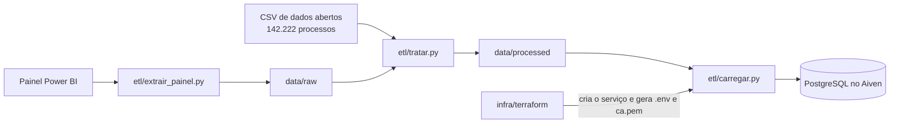
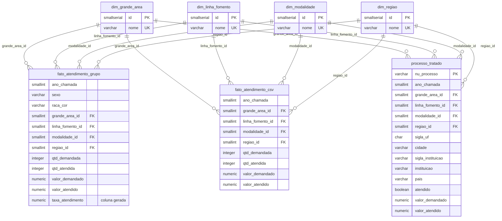

# Fase 2 – Tratamento e Armazenamento dos Dados

Auditoria de viés étnico-racial e de gênero no fomento do CNPq. Trabalho da disciplina Big Data e Analytics (Engenharia de Software, UCSal, 2026).

Equipe:

1. Lucas Alves Matos Sampaio Gaspari
2. Walter Queiroz Rocha
3. Guilherme Ferreira Sampaio

Nesta fase os dados do Painel de Demanda e Atendimento do CNPq são tratados, organizados em um modelo dimensional e carregados em um PostgreSQL na nuvem (Aiven), com a infraestrutura descrita em Terraform.



## Sumário

1. [Estrutura do repositório](#1-estrutura-do-repositório)
2. [Dados utilizados](#2-dados-utilizados)
3. [Tratamento realizado](#3-tratamento-realizado)
4. [Modelagem](#4-modelagem)
5. [Infraestrutura](#5-infraestrutura)
6. [Segurança das informações](#6-segurança-das-informações)
7. [Execução](#7-execução)
8. [Testes](#8-testes)
9. [Limitações](#9-limitações)
10. [Referências](#10-referências)

## 1. Estrutura do repositório

```
.
├── etl/                      código do tratamento
│   ├── extrair_painel.py     extrai do painel os totais por sexo e raça/cor
│   ├── tratar.py             limpa, padroniza, unifica e agrega as duas fontes
│   └── carregar.py           cria o esquema e carrega os CSVs tratados no PostgreSQL
├── sql/schema.sql            tabelas, chaves, restrições e views
├── data/
│   ├── raw/                  extrato original do painel, sem tratamento
│   └── processed/            base tratada (é o que vai para o banco)
├── infra/terraform/          infraestrutura como código
│   ├── versions.tf           versões do Terraform e dos providers
│   ├── variables.tf          parâmetros (projeto, região, plano, IPs liberados...)
│   ├── main.tf               serviço PostgreSQL, banco e usuário de leitura
│   ├── arquivos_locais.tf    gera o .env e o ca.pem usados pelo ETL
│   ├── outputs.tf            host, porta e URLs de conexão (sensíveis)
│   ├── terraform.tfvars.example
│   └── tests/                testes do Terraform com providers simulados
├── tests/                    testes do ETL e do banco
├── docs/AI_04_Fase_3_do_projeto.pdf  relatório da entrega (ABNT)
├── .github/workflows/        CI: testes, validação do Terraform e busca de segredos
├── .env.example              modelo do arquivo de credenciais, sem valores
├── .gitleaksignore           exceção justificada da busca de segredos
└── requirements.txt
```

A base original (`Base_CNPq_Demanda_Atendimento_2019_2024.csv`, 100 MB) não entra no repositório por causa do tamanho. Ela fica na pasta **acima** do projeto (ver [Execução](#7-execução)).

## 2. Dados utilizados

### 2.1 Fonte

As duas fontes vêm do Painel de Demanda e Atendimento do CNPq, na seção de dados abertos do gov.br. O painel usa os dados da Plataforma Integrada Carlos Chagas.

| Fonte | Conteúdo | Como foi obtida |
|---|---|---|
| CSV de dados abertos | Uma linha por processo (proposta submetida) | Download no próprio painel |
| Relatório Power BI do painel | Mesmo cadastro, com sexo e raça/cor do proponente | `etl/extrair_painel.py`, consulta agregada ano a ano |

O CSV não tem sexo nem raça/cor, que são as dimensões centrais da auditoria. O painel mostra essas informações, então extraímos dele só os totais por grupo, sem o número do processo.

### 2.2 Identificação da base

| | CSV de dados abertos | Extrato do painel |
|---|---|---|
| Arquivo | `Base_CNPq_Demanda_Atendimento_2019_2024.csv` | `data/raw/painel_agregado_2019_2024.csv` |
| Tamanho | 100.693.334 bytes | 7.816.392 bytes |
| Linhas | 142.222 | 57.656 combinações |
| Colunas | 39 | 13 (9 dimensões e 4 medidas) |
| Formato | separador `;`, UTF-8 com BOM, textos entre aspas | separador `,`, UTF-8 |
| SHA-256 | `18d9dfddd734ffca2db1310a6e3eaad1cf2a7c2d8af57918a53e525f9da09120` | versionado no repositório |

### 2.3 Período e recorte

- Período: chamadas de 2019 a 2024, pelo campo `ano_chamada`. O `ano_solicitacao` vai até 2026, porque algumas chamadas recebem propostas depois do ano em que foram lançadas, então ele não serve para o recorte.
- Linhas de fomento: Bolsas no País, Bolsas no Exterior e Apoio a Projetos de Pesquisa, as linhas de bolsas e auxílios definidas na Etapa 1. Ficam de fora a chamada ARC (2.217 linhas), eventos (5) e prêmios (1).

### 2.4 Características relevantes

- Cada linha do CSV é um processo, com chamada, modalidade, área, instituição, UF, valores pedidos e concedidos e a situação (`st_atendimento` = `S` ou `N`). No bruto são 47.675 propostas atendidas e 94.547 não atendidas.
- A coluna `nme_linha_fomento` vem com `0.0 - Problemas Encontrar Modalidade Processo` em 85,9% das linhas. A linha de fomento confiável está em `nme_chamada_macro`.
- `nme_modalidade` está vazia em 14.136 linhas (9,9%).
- Títulos e palavras-chave têm `;` no texto (140.934 linhas em `txt_plv_chave`), o mesmo caractere do separador. Um `split(";")` desalinha as colunas; é preciso um leitor de CSV que respeite as aspas.
- A mesma coisa aparece escrita de formas diferentes (`Sao Paulo`, `SAO PAULO`, `São Paulo`), e o nome da UF tem 48 grafias distintas.
- A região vem em sigla (`SE`, `NE`, `\EX` para exterior, `\NI` para não informado).
- No painel, sexo tem `Feminino`, `Masculino` e `Não desejo declarar`; raça/cor tem `Branca`, `Parda`, `Preta`, `Amarela`, `Indígena` e `Não desejo declarar`.

## 3. Tratamento realizado

Feito por `etl/tratar.py` (Python e pandas). O script lê as duas fontes, aplica as mesmas regras nas duas e grava em `data/processed/` os arquivos que vão para o banco, junto com `log_tratamento.csv`, que registra quantas linhas cada regra afetou. Rodar de novo sobre a mesma base gera arquivos idênticos.

### 3.1 Problemas, decisões e justificativas

| Problema ou característica | Decisão | Justificativa |
|---|---|---|
| `;` dentro de títulos e palavras-chave | Leitor CSV do pandas, em blocos de 50 mil linhas, com todas as colunas como texto | Não desloca colunas e o pandas não converte números de processo e códigos por conta própria |
| Sexo e raça/cor ausentes no CSV | Extrair do painel só totais por grupo, sem `NU_PROCESSO` | Raça/cor é dado pessoal sensível (LGPD, art. 5º, II). A auditoria compara grupos, não pessoas |
| `nme_linha_fomento` inválida em 85,9% das linhas | Usar `nme_chamada_macro` como linha de fomento | É a coluna preenchida e bate com as categorias da Etapa 1 |
| Mesma categoria escrita de várias formas | Comparar por uma chave sem acento, caixa e pontuação e ficar com a grafia acentuada mais frequente | Junta `SAO PAULO` e `São Paulo` sem juntar nomes diferentes (`Itabuna` e `Itaúna` continuam separados) |
| UF e nome da UF inconsistentes | Validar a sigla contra a lista oficial das 27 UFs, deduzir a sigla pelo nome quando ela falta e corrigir a região pela UF | Erro de digitação só é corrigido contra a lista oficial, nunca contra outros valores da própria base |
| Modalidade vazia | Deduzir pela mesma chamada em outros anos quando ela só tem uma modalidade; se não der, `Não informado` | As chamadas se repetem (`PQ - 2023`, `PQ - 2024`) com a mesma modalidade |
| Área ligada a uma grande área diferente da usual | Usar a grande área em que essa área aparece em pelo menos 95% das propostas | Corrige classificações isoladas sem mexer em áreas que de fato se dividem |
| Sigla de instituição escrita de jeitos diferentes | Uma sigla por nome de instituição e UF (a mais usada), em maiúsculas e sem acento | `PUC-Rio` e `PUC/RJ` da mesma instituição viram uma só |
| Registros repetidos com número de processo diferente | Remover duplicados exatos e reenvios (mesmo ano, chamada, título, instituição, área e modalidade), mantendo o atendido ou o último envio | O pesquisador às vezes submete de novo a mesma proposta; contar as duas inflaria a demanda |
| Valor demandado igual a zero | Virar nulo | Ninguém pede R$ 0; o zero aqui é falta de informação e puxaria as médias para baixo |
| Bolsa com valor mais de 10 vezes a mediana da modalidade | Dividir por 10, 100 ou 1000 quando o resultado cai entre os percentis 1 e 99 da modalidade (vírgula deslocada); se não cair, virar nulo | Corrige erro de digitação evidente e descarta só o que não tem explicação |
| Projeto com valor mais de 20 vezes a mediana da chamada (chamadas com 20 ou mais propostas) | Virar nulo | Mesma lógica, com limite maior porque o valor de projeto varia mais que o de bolsa |
| Valor atendido maior que o demandado (7.854 casos) | Manter | Pode acontecer de verdade, por exemplo com reajuste de bolsa. Excluir mudaria os totais |
| `Não desejo declarar` e vazios em sexo e raça/cor | Agrupar como `Não informado`, categoria própria | Redistribuir entre os grupos seria inventar dado |
| Medidas de valor do painel dependem do seletor de moeda | Somar direto as colunas de valor em reais | As medidas prontas voltam vazias quando o seletor não está aplicado |
| Taxa de atendimento | Calcular no banco, como coluna gerada | A taxa nunca fica diferente das quantidades armazenadas |
| Amostragem | Não usar | A base cabe inteira no banco e grupos pequenos (indígenas, por exemplo) ficariam instáveis |

### 3.2 Transformações em números

Valores tirados de `data/processed/log_tratamento.csv`:

| Etapa | CSV (linhas) | Painel (combinações) |
|---|---:|---:|
| Lidas | 142.222 | 57.656 |
| Números de processo repetidos | 0 | - |
| Grafias unificadas | cidade 33.985; nome da UF 48.897; instituição 4 | 0 |
| Modalidade vazia deduzida | 14.136 | 2.425 |
| Grande área corrigida | 1 | 16 |
| Recorte 2019-2024 | 142.222 | 57.656 |
| Só bolsas e auxílios à pesquisa | 139.999 | 53.340 |
| Siglas de instituição unificadas | 6.250 | - |
| Duplicados exatos removidos | 14 | - |
| Reenvios removidos | 224 | - |
| Processos após a limpeza | 139.761 | - |
| Valor demandado zero que virou nulo | 66 | - |
| Vírgula deslocada corrigida | 1 | - |
| Valores implausíveis que viraram nulo | 2 | - |
| Combinações após agregar | 1.397 | 9.173 (com demanda > 0) |

A tabela de processos ficou com 14 das 39 colunas, e o arquivo de 100 MB virou 16,4 MB.

### 3.3 Base tratada

Fica em `data/processed/`:

| Arquivo | Conteúdo | Linhas |
|---|---|---:|
| `fato_atendimento_grupo.csv` | Painel agregado por ano, sexo, raça/cor, grande área, linha de fomento, modalidade e região | 9.173 |
| `fato_atendimento_csv.csv` | CSV agregado pelas mesmas dimensões, sem sexo e raça/cor | 1.397 |
| `processo_tratado.csv` | Um processo por linha, já tratado | 139.761 |
| `dim_grande_area.csv`, `dim_linha_fomento.csv`, `dim_modalidade.csv`, `dim_regiao.csv` | Categorias padronizadas, comuns às duas fontes | 11, 3, 13 e 7 |
| `log_tratamento.csv` | Linhas afetadas por cada regra | 44 |

## 4. Modelagem

### 4.1 Estratégia

Usamos um modelo dimensional: duas tabelas fato que compartilham as mesmas dimensões (uma constelação de fatos) e uma tabela com um processo por linha.

O motivo é o tipo de pergunta da auditoria, por exemplo: "qual a taxa de atendimento de mulheres pretas em Engenharias em 2023, comparada à de homens brancos?". É sempre uma medida (propostas, atendimentos, valores) recortada por categorias. No modelo dimensional isso vira um `GROUP BY` simples, e as dimensões compartilhadas garantem que painel e CSV usem os mesmos nomes de área, modalidade e região, o que permite comparar as duas fontes.

Grão de cada tabela:

- `fato_atendimento_grupo`: ano + sexo + raça/cor + grande área + linha de fomento + modalidade + região (painel);
- `fato_atendimento_csv`: ano + grande área + linha de fomento + modalidade + região (CSV);
- `processo_tratado`: um processo. Serve para conferir qualquer agregado contra o registro tratado e para recortes por UF e instituição.

Não normalizamos em 3FN porque não existe escrita transacional: os dados entram em lote e depois só são consultados. Também não usamos NoSQL nem data lake, porque a base é estruturada, tem 16 MB depois de tratada e cabe com folga num PostgreSQL.

### 4.2 Diagrama



### 4.3 Estrutura do banco

Definida em `sql/schema.sql`:

| Objeto | Registros | Observações |
|---|---:|---|
| `fato_atendimento_grupo` | 9.173 | `taxa_atendimento NUMERIC(7,4)` é coluna gerada (`qtd_atendida / qtd_demandada`); `CHECK (qtd_demandada > 0)` |
| `fato_atendimento_csv` | 1.397 | Mesmas medidas, sem sexo e raça/cor |
| `processo_tratado` | 139.761 | `nu_processo` é a chave primária |
| `dim_grande_area`, `dim_linha_fomento`, `dim_modalidade`, `dim_regiao` | 11, 3, 13 e 7 | `nome` com `UNIQUE` |
| `vw_diferenca_grupo` (view) | 740 | Taxa por ano, grande área, sexo e raça/cor, e a diferença para os homens brancos, o maior grupo (67.042 propostas) |
| `vw_reconciliacao_fontes` (view) | 137 | Totais do painel e do CSV lado a lado por ano, grande área e linha de fomento |

Tipos: `SMALLINT` para ano e chaves das dimensões, `NUMERIC(16,2)` para dinheiro (sem erro de arredondamento de ponto flutuante) e `BOOLEAN` para atendido. Carregado no Aiven, o banco ocupa 32 MB, bem abaixo da meta de 650 MB da Etapa 1 e do disco de 1 GB do plano gratuito.

## 5. Infraestrutura

### 5.1 Serviços e tecnologias

| Item | Escolha | Por quê |
|---|---|---|
| Banco de dados | Aiven for PostgreSQL, plano `free-1-1gb` | Gratuito sem prazo e sem cartão de crédito, gerenciado, com backup e TLS. O RDS da AWS exige cartão e o nível gratuito é temporário |
| Região | `do-nyc` (DigitalOcean, Nova York) | O Aiven só cria serviços gratuitos na DigitalOcean e na UpCloud, e nenhuma das duas tem região na América do Sul. Tentamos `aws-us-east-1` e a API recusou (`Free plans are available in cloud(s): DigitalOcean,UpCloud`); Nova York é a opção gratuita mais próxima de Salvador |
| Infraestrutura como código | Terraform 1.7+ com os providers `aiven/aiven` (~> 4.65), `hashicorp/random` (~> 3.7) e `hashicorp/local` (~> 2.5) | O provider oficial do Aiven cobre serviço, banco e usuários; o `random` gera a senha do usuário de leitura; o `local` grava os arquivos de conexão que o ETL lê |
| Tratamento e carga | Python 3.14, pandas, requests e pg8000 | O pg8000 é Python puro: o psycopg teve a DLL bloqueada pelo Controle de Aplicativos do Windows em uma das máquinas da equipe |
| Integração contínua | GitHub Actions | Roda os testes, valida o Terraform e procura segredos em cada push e pull request |

Custo: R$ 0. Limites do plano gratuito que importam aqui: 1 CPU, 1 GB de RAM, 1 GB de disco, 20 conexões simultâneas e um único serviço PostgreSQL gratuito por organização. O Aiven pode desligar serviços gratuitos parados; para religar, use o console (o Terraform não liga nem desliga serviços).

### 5.2 Recursos provisionados

Todos em `infra/terraform/`:

| Recurso | Nome | O que faz |
|---|---|---|
| `data.aiven_project` | `projeto` | Lê o projeto que já vem com a conta e o certificado da CA |
| `aiven_pg` | `banco` | Serviço PostgreSQL 17 com filtro de IP e tags `projeto` e `etapa` |
| `aiven_pg_database` | `fomento` | Banco `fomento_cnpq`, separado do `defaultdb` |
| `random_password` | `leitura` | Senha de 24 caracteres para o usuário de leitura |
| `aiven_pg_user` | `leitura` | Usuário `analise_leitura`, para as próximas fases |
| `local_sensitive_file` | `env`, `ca` | `.env` (permissão 0600) e `ca.pem` na raiz do repositório |

O banco usado na entrega foi criado com esse código, na conta de um integrante: serviço `pg-fomento-cnpq`, plano `free-1-1gb`, região `do-nyc`, PostgreSQL 17. Depois do `apply`, um novo `terraform plan` não mostra nenhuma mudança pendente.

O `cloud_name` está em `ignore_changes` porque o Aiven pode trocar a região de serviços gratuitos. Sem isso, o próximo `terraform plan` tentaria migrar o banco de volta.

A única variável obrigatória é `projeto_aiven`; as demais têm padrão (ver `variables.tf`). As saídas são `host`, `porta`, `banco`, `usuario_carga`, `usuario_leitura` e as duas URLs de conexão, marcadas como `sensitive`.

## 6. Segurança das informações

### 6.1 Onde fica cada credencial

| Credencial | Quem gera | Onde fica | Versionada? |
|---|---|---|---|
| Token da API do Aiven | Cada integrante, no console do Aiven (perfil do usuário, Tokens) | Só na variável de ambiente `AIVEN_TOKEN` do terminal | Não |
| Senha do `avnadmin` (usada na carga) | Aiven, ao criar o serviço | `terraform.tfstate` e `.env` locais | Não |
| Senha do `analise_leitura` | Terraform (`random_password`) | `terraform.tfstate` e `.env` locais | Não |
| Certificado da CA (`ca.pem`) | Aiven | Raiz do repositório, gerado pelo Terraform | Não |

Ninguém digita nem escolhe senha de banco. A do `avnadmin` vem do Aiven e a do usuário de leitura é sorteada pelo Terraform; as duas vão direto para o `.env`, que o `carregar.py` lê. A senha não passa por chat, e-mail ou código.

A senha de leitura começou sendo gerada pelo Aiven, mas a API passou a devolver o texto `<redacted>` no lugar da senha de usuários comuns, e o provider gravava isso no state. O `.env` saía com a senha errada e a conexão falhava. Por isso a senha passou a ser gerada pelo `random_password`.

### 6.2 Medidas adotadas

- **Arquivos ignorados.** O `.gitignore` cobre `.env`, `*.pem`, `*.key`, `*.tfstate*`, `*.tfvars` e `.terraform/`. No repositório ficam só os modelos sem valor: `.env.example` e `terraform.tfvars.example`.
- **Token fora dos arquivos.** O provider lê o `AIVEN_TOKEN` do ambiente. Os comandos da seção 7 leem o token sem mostrar na tela, para ele não ficar no histórico do terminal.
- **Saídas sensíveis.** As URLs de conexão são `sensitive` e não aparecem no `plan` nem no `apply`. Para ver é preciso pedir (`terraform output -raw database_url`).
- **TLS com verificação.** O `carregar.py` conecta com `ssl.create_default_context(cafile="ca.pem")`, que confere a cadeia do certificado e o nome do servidor. Sem o `ca.pem` a carga não roda.
- **Menor privilégio.** O `avnadmin` só é usado na carga. Consultas e painéis das próximas fases usam o `analise_leitura`, que recebe apenas `USAGE` no schema e `SELECT` nas tabelas e views. Os testes confirmam que ele lê tudo mas não consegue apagar dados nem criar tabelas.
- **Filtro de IP.** A variável `ips_liberados` define quem pode conectar. O padrão `0.0.0.0/0` existe porque a equipe trabalha de redes diferentes (casa, faculdade, 4G); com IPs fixos, basta trocar e rodar `terraform apply`.
- **State local.** O `terraform.tfstate` guarda as senhas em texto puro, por isso não é versionado e fica só na máquina de quem aplicou. Se o projeto crescer, o próximo passo é um backend remoto com criptografia e controle de acesso (S3 com KMS ou HCP Terraform).
- **Busca de segredos.** O CI roda o [gitleaks](https://github.com/gitleaks/gitleaks) sobre todo o histórico. A única ocorrência é o `RESOURCE_KEY` em `etl/extrair_painel.py`, que não é credencial: é a chave pública do relatório Power BI publicado na web, a mesma que está no link incorporado da página do painel no gov.br. Ela está liberada no `.gitleaksignore` com essa justificativa.
- **LGPD.** Sexo e raça/cor só existem no banco de forma agregada; não há como ligar esses atributos a um processo ou pessoa.

### 6.3 Se uma credencial vazar

1. Token do Aiven: revogar no console e gerar outro.
2. Senha do `analise_leitura`: `terraform apply -replace=random_password.leitura` sorteia uma senha nova, atualiza o usuário no Aiven e reescreve o `.env`.
3. Senha do `avnadmin`: redefinir na aba Users do serviço, no console, e rodar `terraform apply`, que lê a senha nova e reescreve o `.env`.
4. Se o segredo chegou a ser commitado, apagar o commit não resolve: a credencial precisa ser trocada.

## 7. Execução

### 7.1 Ferramentas e dependências

| Ferramenta | Versão | Uso |
|---|---|---|
| Python | 3.14 | ETL e testes |
| [uv](https://docs.astral.sh/uv/) ou pip | recente | Ambiente virtual e dependências |
| pandas, requests, pg8000 | ver `requirements.txt` | Tratamento, extração e carga |
| Terraform | 1.7 ou mais novo (testado no 1.16) | Provisionar o banco |
| Conta no Aiven | plano gratuito | Hospedar o PostgreSQL |

### 7.2 Sequência

Os comandos estão no formato Linux/macOS. No Windows, troque `.venv/bin/python` por `.venv\Scripts\python`.

**1. Clonar e colocar a base original na pasta acima do projeto**

```bash
git clone https://github.com/Caspiom/Trabalho-big-data.git
# Base_CNPq_Demanda_Atendimento_2019_2024.csv fica ao lado da pasta Trabalho-big-data
sha256sum Base_CNPq_Demanda_Atendimento_2019_2024.csv   # deve bater com o da seção 2.2
cd Trabalho-big-data
```

**2. Ambiente Python**

```bash
uv venv --python 3.14 .venv
uv pip install --python .venv -r requirements.txt
```

**3. Extração do painel (opcional)**

```bash
.venv/bin/python etl/extrair_painel.py
```

Sobrescreve `data/raw/painel_agregado_2019_2024.csv`. O extrato usado no trabalho já está no repositório; rode só para conferir ou atualizar, lembrando que o painel pode ter mudado.

**4. Tratamento**

```bash
.venv/bin/python etl/tratar.py
git status   # nada alterado em data/processed = mesma base tratada do repositório
```

**5. Infraestrutura**

```bash
read -rs AIVEN_TOKEN && export AIVEN_TOKEN   # cola o token; ele não aparece nem vai para o histórico

cp infra/terraform/terraform.tfvars.example infra/terraform/terraform.tfvars
# edite terraform.tfvars com o nome do seu projeto no Aiven

terraform -chdir=infra/terraform init
terraform -chdir=infra/terraform plan
terraform -chdir=infra/terraform apply
```

No PowerShell, o token entra com `$env:AIVEN_TOKEN = Read-Host "Token do Aiven" -MaskInput`.

O `apply` demora alguns minutos (é o tempo de o serviço subir) e no fim cria o `.env` e o `ca.pem` na raiz do repositório.

Se o serviço gratuito já existir (criado antes pelo console), não tente criar outro: o Aiven só permite um por organização. Importe o serviço para o Terraform e rode o `apply`, que cria apenas o banco, o usuário de leitura e os arquivos:

```bash
terraform -chdir=infra/terraform import -var nome_servico=<servico> aiven_pg.banco <projeto>/<servico>
terraform -chdir=infra/terraform apply -var nome_servico=<servico>
```

Antes de confirmar, veja no `plan` se a versão do PostgreSQL bate com a do serviço (`-var versao_postgres=...`), para não disparar uma atualização de versão.

**6. Carga**

```bash
.venv/bin/python etl/carregar.py
```

Recria o esquema, carrega os sete arquivos numa única transação (se algo falhar, nada fica pela metade), libera leitura para o `analise_leitura` e mostra linhas e tamanho de cada tabela.

**7. Testes**

```bash
.venv/bin/python -m unittest discover -s tests -v
terraform -chdir=infra/terraform test
```

**8. Remover a infraestrutura, quando o projeto acabar**

```bash
terraform -chdir=infra/terraform destroy
```

### 7.3 Consultar o banco

A URL do `.env` já aponta para o `ca.pem`, então funciona direto no `psql` a partir da raiz do repositório:

```bash
psql "$(grep '^DATABASE_URL_LEITURA=' .env | cut -d= -f2-)" \
  -c "SELECT * FROM vw_diferenca_grupo WHERE ano_chamada = 2024 ORDER BY diferenca_grupo LIMIT 10"
```

## 8. Testes

| Arquivo | O que confere | Testes |
|---|---|---:|
| `tests/test_extrair_painel.py` | Decodificação do formato DSR do Power BI e montagem da consulta | 8 |
| `tests/test_tratar.py` | Cada regra de limpeza isolada e as invariantes da base tratada (UF coerente com a região, uma grafia por cidade, valores positivos, linhas removidas explicadas pelo log...) | 29 |
| `tests/test_banco.py` | Linhas no banco iguais às dos arquivos, taxa gerada, views, reconciliação, tamanho e permissões do usuário de leitura | 8 |
| `infra/terraform/tests/banco.tftest.hcl` | Plano gratuito, nome do banco, `.env` com senha codificada e permissão 0600, validação dos IPs | 4 |

Os testes de banco são pulados sem `.env` e `ca.pem`, e o de comparação com o original é pulado sem o CSV na pasta acima. Os testes do Terraform usam providers simulados (`mock_provider`), então não precisam de conta nem criam nada.

O workflow `.github/workflows/verificacao.yml` roda os testes Python, `terraform fmt`, `validate` e `test`, e o gitleaks em cada push e pull request.

## 9. Limitações

- O painel tem mais propostas que o CSV no mesmo recorte: 184.794 contra 139.761. A diferença aparece em `vw_reconciliacao_fontes` e não foi ajustada artificialmente. A análise de viés usa o painel, que é a fonte com sexo e raça/cor; o CSV serve para conferência e para os recortes por instituição e UF.
- A extração do painel depende de uma API interna do Power BI, sem documentação, que pode mudar. Por isso o extrato bruto fica em `data/raw/`.
- Os limites de limpeza (95% para grande área, 10 e 20 vezes a mediana para valores) foram escolhidos olhando a base. Estão como constantes no topo de `tratar.py`, fáceis de revisar.
- O plano gratuito não tem alta disponibilidade nem SLA, e o serviço pode ser desligado por falta de uso.

## 10. Referências

- AIVEN. Aiven for PostgreSQL free tier. Disponível em: https://aiven.io/docs/products/postgresql/concepts/pg-free-tier.
- AIVEN. Aiven Provider for Terraform. Disponível em: https://registry.terraform.io/providers/aiven/aiven/latest/docs.
- BRASIL. Lei nº 13.709, de 14 de agosto de 2018. Lei Geral de Proteção de Dados Pessoais (LGPD).
- CNPQ. Painel de Demanda e Atendimento. Disponível em: https://www.gov.br/cnpq/pt-br/acesso-a-informacao/dados-abertos/paineis-de-dados/painel-de-demanda-e-atendimento.
- HASHICORP. Terraform tests. Disponível em: https://developer.hashicorp.com/terraform/language/tests.
- KIMBALL, R.; ROSS, M. The Data Warehouse Toolkit. 3. ed. Indianapolis: Wiley, 2013.
